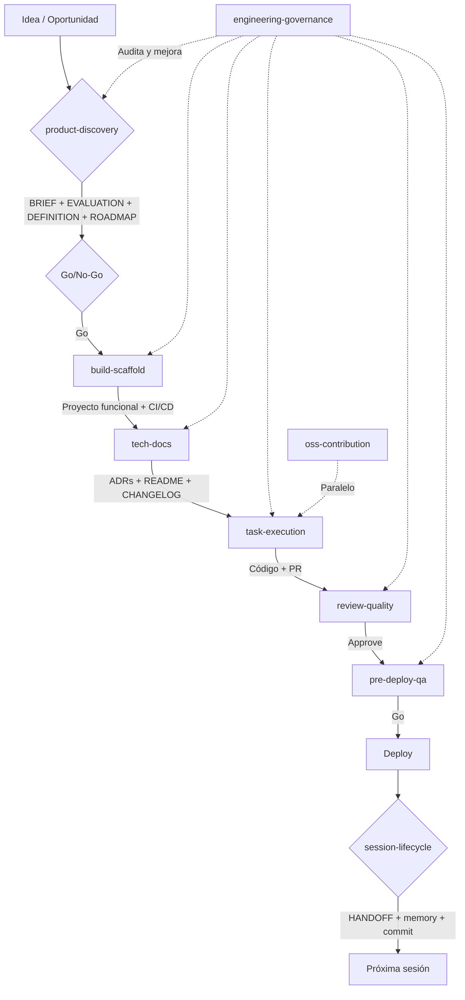

# Kanam Product Pipeline

> **Pipeline de skills para llevar una idea a producto funcionando en producción.**
>
> Skills actuales del workspace, mapeados en secuencia.

## Skills del pipeline

| Fase | Skill | Qué hace | Reemplaza a |
|------|-------|----------|-------------|
| 0. Discovery | `product-discovery` | Idea → BRIEF + EVALUATION + DEFINITION + ROADMAP + Go/No-Go | product-orchestrator, profile-positioning, openspec-creator, product-reset |
| 1. Scaffold | `build-scaffold` | Generar proyecto, configurar stack, CI/CD | web-app-builder, workspace-scaffold, scaffold-verify, ai-scaffold, ai-copilot-structure |
| 2. Docs | `tech-docs` | ADRs, README, CHANGELOG, diagramas de arquitectura | adr-framework, adr-sync |
| 3. Ejecución | `task-execution` | Planificar, branch, implementar, PR, mergear, cerrar epic | — |
| 4. Calidad | `review-quality` | Code review, tests, seguridad, producto | pr-review, po-review, security-audit, agent-review |
| 5. Pre-deploy | `pre-deploy-qa` | Build, rutas, SEO, performance, seguridad, cleanup | — |
| 6. Sesión | `session-lifecycle` | Inicio, dispatcher, cierre, HANDOFF, memory, commit | session-closure, session-closure-ritual, context-management, agent-dispatcher |
| — | `engineering-governance` | (Transversal) Auditar y mejorar el sistema de workflows | — |
| — | `oss-contribution` | (Transversal) Contribución estratégica a OSS | oss-contribute, sdd-brownfield |

## Mapa del pipeline



## Flujo típico

### Proyecto nuevo
```
product-discovery → build-scaffold → tech-docs → task-execution → review-quality → pre-deploy-qa → session-lifecycle
```

### Feature sobre proyecto existente
```
task-execution → review-quality → pre-deploy-qa → session-lifecycle
```

### Solo documentación
```
tech-docs → session-lifecycle
```

### Solo investigación
```
product-discovery (modo ideación) → session-lifecycle
```

## Skills transversales

- **engineering-governance**: se ejecuta periódicamente (post-milestone, post-epic) para auditar y mejorar el sistema completo.
- **oss-contribution**: pipeline paralelo para contribuir a repos externos. No forma parte del flujo principal de producto.

## Skills que ya no existen (absorbidos)

| Skill viejo | Absorbido por |
|-------------|---------------|
| `profile-positioning` | product-discovery |
| `product-orchestrator` | product-discovery |
| `openspec-creator` | product-discovery |
| `product-reset` | product-discovery |
| `web-app-builder` | build-scaffold |
| `workspace-scaffold` | build-scaffold |
| `scaffold-verify` | build-scaffold |
| `ai-scaffold` | build-scaffold |
| `ai-copilot-structure` | build-scaffold |
| `adr-framework` | tech-docs |
| `adr-sync` | tech-docs |
| `pr-review` | review-quality |
| `po-review` | review-quality |
| `security-audit` | review-quality |
| `agent-review` | review-quality |
| `session-closure` | session-lifecycle |
| `session-closure-ritual` | session-lifecycle |
| `context-management` | session-lifecycle |
| `agent-dispatcher` | session-lifecycle |
| `oss-contribute` | oss-contribution |
| `sdd-brownfield` | oss-contribution |

---

*Actualizado: 2026-07-22*  
*Skills del workspace: skills/*  
*Estado: 🟢 Al día*
