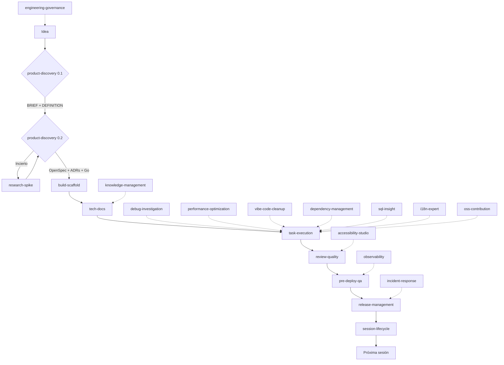

# Kanam Product Pipeline

> **Pipeline de skills para llevar una idea a producto funcionando en producción.**
>
> 33 skills del workspace mapeadas en secuencia y por contexto.

## Pipeline principal (flujo de producto)

| Fase | Skill | Qué hace |
|---|---|---|
| 0.1 Brainstorming | `product-discovery` (0.1) | Idea → BRIEF + DEFINITION. Modelo: GLM 5.2 |
| 0.2 Arquitectura | `product-discovery` (0.2) | OpenSpec + ADRs + ROADMAP. Modelo: Kimi K2.7 |
| 0.5 Investigación | `research-spike` | Reducir incertidumbre técnica antes de decidir |
| 1. Scaffold | `build-scaffold` | Generar proyecto, configurar stack, CI/CD |
| 2. Docs iniciales | `tech-docs` | ADRs, diagramas C4, README, CHANGELOG |
| 3. Ejecución | `task-execution` | Planificar, branch, implementar, PR, mergear, cerrar epic |
| 4. Calidad | `review-quality` | Code review, tests, seguridad OWASP, spec compliance |
| 5. Pre-deploy | `pre-deploy-qa` | Build, rutas, SEO, API, performance, seguridad, cleanup |
| 6. Release | `release-management` | Versionado, release notes, rollback plan, deploy |
| 7. Sesión | `session-lifecycle` | Inicio, dispatcher, cierre, HANDOFF, memory, commit |

## Pipeline de soporte (transversales)

| Contexto | Skill | Cuándo |
|---|---|---|
| Bug | `debug-investigation` | Cuando algo no funciona y no sabemos por qué |
| Performance | `performance-optimization` | Cuando Lighthouse está bajo o hay latencia |
| Código IA | `vibe-code-cleanup` | Cuando limpiás código generado por IA |
| Dependencias | `dependency-management` | Cuando evaluás, actualizás o auditás librerías |
| SQL | `sql-insight` | Cuando escribís o optimizás queries |
| i18n | `i18n-expert` | Cuando agregás internacionalización |
| Accesibilidad | `accessibility-studio` | Cuando auditás o corregís accesibilidad |
| Observabilidad | `observability` | Cuando necesitás métricas, logs o tracing |
| Incidente | `incident-response` | Cuando hay una caída o degradación en producción |
| Gobernanza | `engineering-governance` | Post-milestone: auditar y mejorar el sistema |
| Conocimiento | `knowledge-management` | Cuando la documentación está inconsistente |
| OSS | `oss-contribution` | Cuando contribuís a repos externos |

## Pipeline de carrera y contenido

| Contexto | Skill | Cuándo |
|---|---|---|
| Búsqueda laboral | `cv-tailor` | Cuando optimizás CV para una postulación |
| Entrevistas | `mock-interview-drill` | Cuando practicás entrevistas |
| Aprender | `code-mentor` | Cuando estudiás programación |
| Tutoriales | `dev-guide-generator` | Cuando escribís guías técnicas |
| Copy | `copy-editing` | Cuando editás copy de marketing |
| Campañas | `campaign-plan` | Cuando planeás un lanzamiento |
| Soporte | `support-response-writer` | Cuando redactás respuestas a clientes |
| Naming | `brand-name-forge` | Cuando nombrás un producto o empresa |
| Narrativa | `narrative-content` | Cuando escribís ficción |
| Timelines | `timeline-builder` | Cuando visualizás cronologías |
| ADHD | `adhd-assistant` | Cuando necesitás estructura diaria |
| SaaS | `saas-metrics-coach` | Cuando evaluás salud financiera |

## Mapa del pipeline



## Flujos típicos

### Proyecto nuevo completo
```
product-discovery 0.1 → product-discovery 0.2 → research-spike (opcional) → 
build-scaffold → tech-docs → task-execution → review-quality → 
pre-deploy-qa → release-management → session-lifecycle
```

### Feature sobre proyecto existente
```
task-execution → review-quality → pre-deploy-qa → session-lifecycle
```

### Bug
```
debug-investigation → task-execution → review-quality → session-lifecycle
```

### Solo documentación
```
tech-docs → session-lifecycle
```

### Solo investigación
```
product-discovery 0.1 → product-discovery 0.2 → research-spike → session-lifecycle
```

---

*Actualizado: 2026-07-25*
*Skills del workspace: 34*
*Estado: 🟢 Al día*
