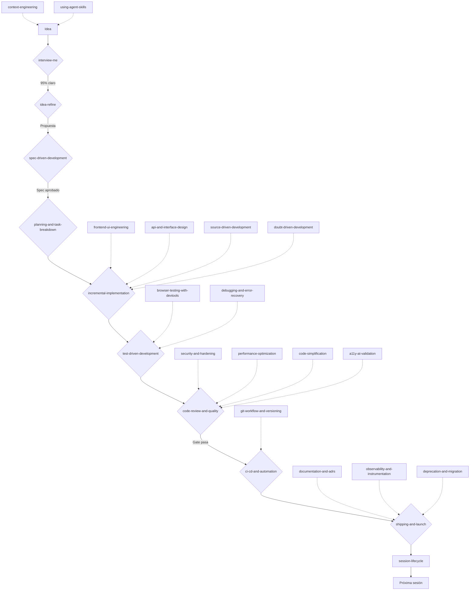

# Kanam Product Pipeline

> **Pipeline de skills para llevar una idea a producto funcionando en producción.**
>
> Reescrito 2026-08-06 tras la consolidación de skills (96 → 60 activas). El set adoptó el formato y los nombres del ciclo Define→Plan→Build→Verify→Review→Ship (estilo `addyosmani/agent-skills`) como **estructura de organización**, combinado con skills propias pre-existentes del workspace y con skills 100% propias (accesibilidad, infraestructura OpenClaw, vida). No es una adopción literal del set de Addy - es nuestro set propio, organizado con ese esquema.

## Pipeline principal (flujo de producto)

### Define — Clarificar qué construir
| Fase | Skill | Qué hace |
|---|---|---|
| 0.1 Intención | `interview-me` | Interroga de a 1 pregunta por vez hasta 95% de claridad del requerimiento real |
| 0.2 Idea | `idea-refine` | Pensamiento divergente/convergente para afinar ideas vagas en propuestas |
| 0.3 Spec | `spec-driven-development` | PRD completo: objetivos, arquitectura, data model, acceptance criteria, traceability |

### Plan — Descomponer el trabajo
| Fase | Skill | Qué hace |
|---|---|---|
| 1. Breakdown | `planning-and-task-breakdown` | Descompone el spec en tareas atómicas verificables con dependency ordering |

### Build — Escribir el código
| Fase | Skill | Qué hace |
|---|---|---|
| 2. Implementación | `incremental-implementation` | Slices verticales finos: implementar, testear, verificar, commitear |
| 2.1 Tests | `test-driven-development` | Red-Green-Refactor, test pyramid, DAMP, Beyonce Rule |
| 2.2 UI | `frontend-ui-engineering` | UI accesible (WCAG 2.1 AA), responsive, design system |
| 2.3 API | `api-and-interface-design` | Contract-first, Hyrum's Law, error semantics, boundary validation |
| 2.4 Framework | `source-driven-development` | Cada decisión de framework respaldada por documentación oficial citada |
| 2.5 Decisiones | `doubt-driven-development` | Revisión adversarial en contexto fresco antes de que una decisión no trivial quede firme |

### Verify — Probar que funciona
| Fase | Skill | Qué hace |
|---|---|---|
| 3. Verificación | `browser-testing-with-devtools` | Pruebas en vivo con Chrome DevTools: DOM, console, network, performance |
| 3.1 Debug | `debugging-and-error-recovery` | Triage de 5 pasos: reproduce, localize, reduce, fix, guard |

### Review — Gates de calidad pre-merge
| Fase | Skill | Qué hace |
|---|---|---|
| 4. Review | `code-review-and-quality` | Review de 5 ejes, severity labels, change sizing, mentorship feedback |
| 4.1 Simplificación | `code-simplification` | Chesterton's Fence, Rule of 500, reducir complejidad preservando comportamiento |
| 4.2 Seguridad | `security-and-hardening` | OWASP Top 10, auth patterns, secrets management |
| 4.3 Performance | `performance-optimization` | Measure-first, Core Web Vitals, profiling, bundle analysis |

### Ship — Desplegar con confianza
| Fase | Skill | Qué hace |
|---|---|---|
| 5. Git | `git-workflow-and-versioning` | Trunk-based, atomic commits, commit-as-save-point |
| 5.1 CI/CD | `ci-cd-and-automation` | Shift Left, feature flags, quality gate pipelines |
| 5.2 Deprecación | `deprecation-and-migration` | Code-as-liability, migraciones seguras, zombie code |
| 5.3 Docs/ADRs | `documentation-and-adrs` | ADRs, API docs, documentar el *why* |
| 5.4 Observabilidad | `observability-and-instrumentation` | Structured logging, RED metrics, OpenTelemetry, alerting |
| 5.5 Launch | `shipping-and-launch` | Pre-launch checklists, staged rollouts, rollback plan |
| 6. Sesión | `session-lifecycle` | Inicio, dispatcher, cierre, HANDOFF, memory, commit |

## Pipeline de soporte (transversales)

| Contexto | Skill | Cuándo |
|---|---|---|
| No sé qué quiero | `interview-me` | El pedido está subespecificado |
| Contexto degradado | `context-engineering` | El agente pierde foco, ignora convenciones, alucina |
| Qué skill aplica | `using-agent-skills` | Al empezar sesión, mapear el trabajo a la skill correcta |
| Conocimiento | `knowledge-management` | Documentación inconsistente, learning signals |
| Gobernanza | `engineering-governance` | Post-milestone: auditar y mejorar el sistema |
| Contribución OSS | `oss-contribution` | Contribuir a repos externos: triaje, seguimiento de issues/PRs, community |
| SQL | `sql-insight` | Escribir u optimizar queries |
| Supabase | `supabase-assistant` | Schemas, queries, types, migrations |
| i18n | `i18n-expert` | Agregar internacionalización |
| Accesibilidad (a11y) | `a11y-at-validation` | Validar AT manual cuando el cambio toca el anuncio del screen reader (tests no bastan); distinguir hallazgo intencional vs bug |
| Documentación | `tech-docs` | ADRs, README, API docs, CHANGELOG |

## Pipeline de carrera y contenido

| Contexto | Skill | Cuándo |
|---|---|---|
| Búsqueda laboral | `cv-tailor` | Optimizar CV para una postulación |
| Entrevistas | `mock-interview-drill` | Practicar entrevistas |
| Copy | `copy-editing` | Editar copy de marketing |
| Campañas | `content-serializer` | Serializar contenido multi-plataforma |
| Naming | `brand-name-forge` | Nombrar producto o empresa |
| Narrativa | `narrative-content` | Escribir ficción |
| ADHD | `adhd-assistant` | Estructura diaria |
| Soporte | `support-response-writer` | Respuestas a clientes |

## Mapa del pipeline



## Flujos típicos

### Proyecto nuevo completo
```
interview-me → idea-refine → spec-driven-development → planning-and-task-breakdown →
incremental-implementation (+ test-driven-development) → code-review-and-quality →
ci-cd-and-automation → shipping-and-launch → session-lifecycle
```

### Feature sobre proyecto existente
```
spec-driven-development → planning-and-task-breakdown → incremental-implementation →
code-review-and-quality → ci-cd-and-automation → session-lifecycle
```

### Bug
```
debugging-and-error-recovery → incremental-implementation (con test que reproduce) →
code-review-and-quality → session-lifecycle
```

### Solo documentación
```
documentation-and-adrs → tech-docs → session-lifecycle
```

### Solo investigación
```
interview-me → idea-refine → source-driven-development (citar fuentes oficiales) → session-lifecycle
```

### Contribución OSS
```
oss-contribution (pipeline → triaje → análisis) → incremental-implementation →
oss-contribution (PR → post-PR watch → community → batch → registry) → session-lifecycle
```

### PR de accesibilidad (OSS)
```
oss-contribution (triaje) → incremental-implementation (fix a11y con tests) →
a11y-at-validation (validación AT manual obligatoria: anuncio, captions, casos límite) →
oss-contribution (documentar en PR/issue, separar hallazgos) → session-lifecycle
```

---

*Actualizado: 2026-08-12 (agregada skill a11y-at-validation: validación AT manual obligatoria en PRs de a11y)*
*Skills del pipeline: set propio organizado en ciclo SDLC (estilo Addy Osmani) + core OpenClaw + skills 100% propias (accesibilidad, vida)*
*Estado: 🟢 Al día*
