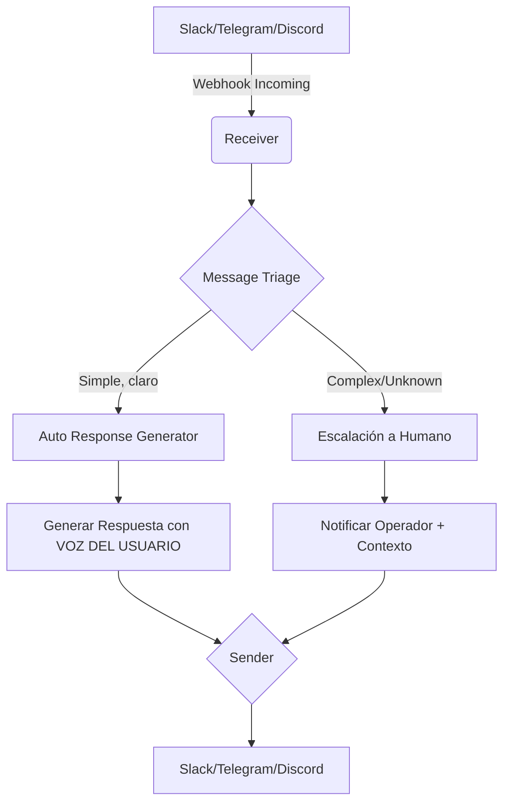

# Módulo 1 - Lección 01: Respuestas Autónomas en Canales de Chat Activos

**Curso:** OpenClaw Use Cases  
**Módulo:** 1/6 - Asistentes de Mensajería Contextuales  
**Lección:** 01/30  
**Fecha:** 2026-10-10  
**Estado:** 🔄 En curso

---

## 📌 Objetivo de la Lección

Automatiza la interacción en canales de chat delegando respuestas seguras y manteniendo tu propio estilo conversacional.

### ¿Qué vamos a lograr?
Crear asistencias automatizadas que puedan responder mensajes en tiempo real en canales como Slack, Telegram, Discord o mensajería propietaria, sin sacrificar control humano ni voz personal.

---

## 🎯 Conceptos Clave

### 1. **Respuestas Autónomas Seguras**
- El agente puede responder automáticamente a mensajes que cumplan ciertos criterios
- Si hay duda, ambigüedad o necesidad de decisión humana → **escala a operador**
- Mantén siempre la puerta abierta para intervención manual cuando el contexto lo pide

### 2. **Estilo Conversacional Personal**
- No es un bot genérico: respeta tu voz (SOUL.md)
- Las respuestas reflejan la personalidad del usuario, no patrones rígidos
- Se adapta al tono y estilo de comunicación del canal

### 3. **Delegación Inteligente**
- El agente toma acción cuando está seguro
- Sabe cuándo NO actuar: menciones críticas, preguntas complejas, situaciones ambiguas
- Transfiere suavemente a humanos sin perder contexto ni hilo conversacional

---

## 🔧 Componentes Técnicos

| Componente | Función | Herramienta Principal |
|------------|---------|---------------------|
| **Webhook Receiver** | Escucha mensajes entrantes | `webhook` (HTTP) |
| **Message Triage** | Clasifica mensajes por tipo/intención | `skill_workshop` + LLM |
| **Router** | Decide: responder/escalar/desechar | `router` (OpenClaw plugin) |
| **Context Manager** | Gestiona historial de conversación | `memory` / `knowledge` |
| **Sender** | Envia respuesta al canal | `message`, `webhook` POST |

---

## 🏗️ Arquitectura Básica



---

## 📋 Criterios de Clasificación (Triage)

### Tipo 1: Respuestas Automáticas ✅
- Mensajes simples y directos: "¿cómo estás?", "hola"
- Peticiones claras dentro del dominio del agente
- Comandos conocidos o preguntas frecuentes (FAQs)
- Confirmaciones/acknowledgments sin ambigüedad

### Tipo 2: Escalación Requerida ⚠️
- Preguntas fuera de alcance del agente
- Solicitudes que requieren decisiones comerciales
- Información crítica/sensitiva (datos, finanzas, seguridad)
- Ambigüedades importantes ("podrías pasarme X" - ¿cuál es el X?)
- Mensajes con múltiples interpretaciones posibles

### Tipo 3: Desechar/Ignore ❌
- Spams o mensajes repetitivos del mismo usuario (con límites razonables)
- Contenido malicioso/toxic
- No hay contexto suficiente para responder útil
- Mensajes claramente no dirigidos al bot

---

## 🛠️ Implementación Paso a Paso

### Paso 1: Endpoint de Recepción (Webhook Incoming)

```bash
# Ejemplo con curl para testear el endpoint
POST https://api.openclaw.ai/v1/webhooks/chat/autonomous-response
Content-Type: application/json

{
  "channel_id": "C123456",
  "event_type": "message",
  "timestamp": "2026-10-10T14:00:00Z",
  "message_content": "Hola, ¿cómo estás?",
  "sender": {
    "id": "U987654",
    "name": "Gonzalo",
    "bot_type": "human"
  },
  "context": {
    "thread_id": null,
    "previous_messages": []
  }
}
```

### Paso 2: Triage de Mensajes

El agente recibe el payload y ejecuta un **triage gate**:

1. **Validación de formato:** ¿el mensaje cumple estructura básica?
2. **Detección de intención:** ¿qué quiere el usuario? (LLM)
3. **Evaluación de complejidad:** ¿esto lo puede manejar o necesita humano?
4. **Decisión:** Auto / Escalar / Ignorar

### Paso 3: Generación de Respuestas

Si es auto → generar respuesta usando `skill_workshop` con:
- Tu contexto de personalidad (SOUL.md)
- Reglas del canal específico
- Historial conversacional reciente

### Paso 4: Envío a Canal

POST al endpoint nativo o webhook original:
```bash
curl -X POST https://hooks.slack.com/services/xxx/yyy/zzz \
  -H "Content-Type: application/json" \
  -d '{
    "channel": "C123456",
    "text": "Hola Gonzalo, estoy funcionando perfectamente! ¿En qué puedo ayudarte?"
  }'
```

### Paso 5: Logging y Observabilidad

Registrar:
- Timestamp de llegada
- Timestamp de respuesta
- Tiempo de procesamiento
- Decision tomada (auto/escalado/desechado)
- Payload completo (para auditoría)

---

## 🧪 Ejemplo Práctico: Conversación en Slack

### Mensaje 1 del usuario → Auto
```json
{
  "channel_id": "C001",
  "message_content": "Hola, ¿estás disponible?"
}
```

**Respuesta automática:**
```json
{
  "text": "Hola Gonzalo, sí estoy disponible! 🌿 ¿En qué te ayudo hoy?"
}
```

### Mensaje 2 del usuario → Escalar ⚠️
```json
{
  "channel_id": "C001",
  "message_content": "Necesito que revises los números de Q3 y me digas si estamos en range antes de las 3PM"
}
```

**Acción:** Escalar a operador + notificar:
```json
{
  "action": "escalated",
  "reason": "Solicitud comercial crítica que requiere análisis financiero y toma de decisiones",
  "context_summary": "Usuario quiere revisión de KPIs Q3 con deadline",
  "message_to_operator": "@Gonzalo tiene una solicitud urgente de revisión financiera Q3"
}
```

---

## 🎯 Principios Fundamentales

1. **Primum non nocere (primero, no hacer daño):** Antes de responder, evalúa si es seguro
2. **Menos es más:** No responder a todo; responder solo a lo manejable
3. **Voz humana:** Nunca se pierde la intervención manual completa
4. **Contexto importa:** La respuesta depende de qué pasó antes, no solo del mensaje actual
5. **Transparencia:** Si escalas, explica por qué

---

## 📊 Métricas de Éxito

| Métrica | Objetivo | Medición |
|---------|----------|----------|
| Tasa de resolución automática | 80%+ | % mensajes resueltos sin humano |
| Tiempo promedio de respuesta | < 5s | Latencia webhook → response |
| Tasa de escalación apropiada | 20-25% | % que fue a operador (no más, no menos) |
| Falso negativo (escaló cuando podía auto) | 0% | Review manual de decisiones de escalación |

---

## 🚦 Siguientes Pasos en el Módulo

Tras completar esta lección, avanzaremos hacia:

- **Lección 02:** Filtrado Selectivo de Notificaciones y Menciones
- Qué mensajes NO queremos que se procesen automáticamente
- Detección de mentions no intencionales, spam, etc.

---

## 📚 Referencias Técnicas

- [OpenClaw Webhook Documentation](https://docs.openclaw.ai/plugins/webhook)
- [Skill Workshop Reference](https://docs.openclaw.ai/workshop/skills)
- [Detalle operativo de AGENTS](../docs/AGENTS-DETALLE.md)
- [Embudo de entrada conversacional (ADR-086)](../docs/adr/ADR-086-embudo-de-entrada-conversacional.md)

---

*Documento generado siguiendo el plan del curso OpenClase Use Cases*
