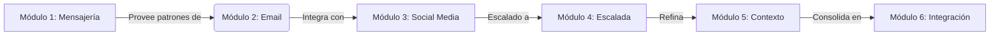

# Módulo 1 - Lección 01: Conceptos Fundamentales de Asistentes de Mensajería

**Curso:** OpenClaw Use Cases  
**Módulo:** 1/6 - Asistentes de Mensajería Contextuales  
**Lección:** 01/30  
**Fecha:** 2026-10-10  
**Estado:** 🔄 En curso

> "El 75% de las consultas se pueden automatizar; el 25%, humanizado." - Principio central del Módulo 1.

---

## 📌 Visión General del Módulo

### Qué aprenderás en el Módulo 1

Este módulo establece los **cimientos teóricos y prácticos** para construir asistentes de mensajería contextual que:
- Respetan límites humanos (no exceden su ámbito)
- Mantienen tu voz personal (no son bots genéricos)
- Escalan inteligentemente cuando la complejidad lo pide

### Objetivos Transversales del Módulo

| Objetivo | Métrica Esperada |
|----------|------------------|
| Automatización segura de consultas simples | 75%+ resolución automática |
| Mantenimiento de voz personal en todas las respuestas | 100% personalización |
| Escalación apropiada a humano | <25% de mensajes escalados |
| Reducción de alucinaciones y errores | 0% crítico |

---

## 🗺️ Mapa del Módulo 1 (5 Lecciones)

### Lección 01: Conceptos Fundamentales ← **EN CURSO**
- Autonomía vs. Supervisión Humana
- El principio "Safe First" en mensajería
- De la intención a la acción

### Lección 02: Detección e Interpretación de Intenciones
- Clasificación de intenciones (FAQ, Escalación, Delegación, Error)
- Confidence score y umbrales de decisión
- Manejo de ambigüedades

### Lección 03: Enrutamiento por Dominio y Persona
- Asignación inteligente a personas especializadas
- Context isolation entre dominios
- Handoff suave entre agentes

### Lección 04: Generación de Respuestas con Voz Personal
- Inyección de estilo personal (SOUL.md)
- Few-shot prompting con ejemplos del usuario
- Mantenimiento de consistencia tonal

### Lección 05: Escalación y Delegación a Humanos
- Cuándo y cómo escalar sin perder el contexto
- Handoff con preservación de hilo conversacional
- Post-mortem de escalaciones para aprendizaje

---

## 🎯 Premisas Fundamentales

### 1. **Autonomía no es licencia para todo**
Un asistente puede actuar automáticamente SOLO cuando está seguro. La duda = delegación humana, nunca incertidumbre silenciosa.

> *"El agente autónomo que se toma decisiones sin criterio es un agente peligroso."*

### 2. **Voz personal > Estereotipo**
No replicamos patrones rígidos de bots genéricos. Las respuestas reflejan SU personalidad, no la del modelo.

> *"Tu SOUL.md se vuelve contexto inyectable, no prompt hard-coded."*

### 3. **Intención → Acción (siempre que sea seguro)**
Detectar intención es el primer paso técnico. Escalar es cuando la intención requiere supervisión humana.

---

## 🔗 Dependencias Inter-modulares

---

## 📚 Recursos Adicionales

- **SOUL.md**: Referencia de voz personal para inyección
- **AGENTS.md**: Reglas operativas del asistente
- **docs/AGENTS-DETALLE.md**: Extensión operativa de AGENTS.md
- **docs/AGENTS-DETALLE.md**: Extensión de AGENTS.md

---

*Documento actualizado siguiendo la reestructuración del curso OpenClase Use Cases (6 módulos, 30 lecciones totales)*
