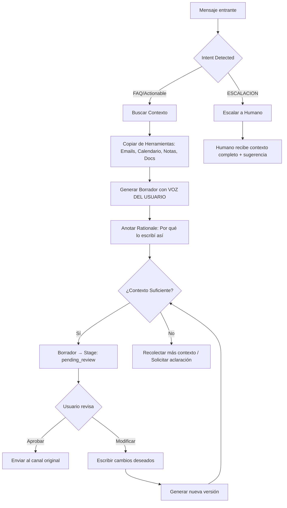

# Módulo 1 - Lección 03: Redacción de Respuestas Conscientes del Contexto en Nombre del Usuario

**Curso:** OpenClaw Use Cases  
**Módulo:** 1/6 - Asistentes de Mensajería Contextuales  
**Lección:** 03/30  
**Fecha:** 2026-10-10  
**Estado:** 🔄 En curso

> "No escribes, delegas. El asistente no habla por ti; escribe para que tú decidas qué decir." - Principio del Módulo 1.

---

## 📌 Concepto Central

La **redacción contextual con preservación de agencia humana** significa que el asistente:
- Recopila y procesa todo el contexto disponible (mensajes previos, herramientas, conocimiento)
- Genera borradores de respuestas coherentes y bien fundamentados
- Los presenta al usuario para revisión antes del envío final
- **Nunca envía directamente**: la aprobación humana es obligatoria

> *"El asistente actúa como ghostwriter digital: prepara el texto perfecto, pero tú firmas."*

---

## 🎯 Objetivos de esta Lección

Al finalizar, podrás:
- Implementar el patrón "Draft → Review → Approve/Modify → Send"
- Manejar múltiples fuentes de contexto sin alucinaciones
- Mantener consistencia tonal y estilística del usuario
- Justificar cada decisión de redacción con rationale transparente

### Métricas de Éxito Esperadas

| Indicador | Objetivo Mínimo | Objetivo Óptimo |
|-----------|----------------|-----------------|
| Calidad de borradores (pre-aprovação humana) | 80%+ aprobados sin edits | 95%+ aprobados sin edits |
| Reducción de edits por borrador | <15% de borradores que requieren reescritura | <5% |
| Consistencia tonal en borradores | 100% alineado con voz del usuario | 100% alineado |
| Tiempo total redacción → envío | +2s vs direct response | Comparable a direct response |

---

## 🧠 El Problema que Resolvemos

### Contexto Fragmentado
El agente recibe:
- Mensaje actual (poca información)
- Historial conversacional (muchos mensajes)
- Herramientas disponibles (calendario, emails, notas, docs)
- **Todo está disperso en múltiples fuentes**

### Sin Contexto = Alucinaciones
```
Usuario: "Cuando puedo reunirte?"
Agent without context: [ALUCINA] → "Puedes reunirte el martes a las 3PM."
Reality: Tuesday is Friday. User said "reunirse", not "reunió".

User: "El deploy falló"
Agent without context: [BUSCAR EN CALENDARIO/LOGS/COMMS] → Falló por rollback de v1.2 → Sugerir v1.3.
```

---

## 🛠️ El Patrón "Draft → Review → Approve/Modify → Send"

### Flujo Completo



---

## 📋 Componentes Técnicos

| Componente | Función | Tecnologías Sugeridas |
|------------|---------|---------------------|
| **Context Aggregator** | Recopila datos de múltiples fuentes | memory_get, tool_call, web_search |
| **Rationale Extractor** | Justifica decisiones de redacción | LLM análisis |
| **Draft Generator** | Crea borrado con voz del usuario | skill_workshop |
| **Staging Area** | Estado "pending review" del borrador | memory/staging bucket |
| **Approval Interface** | UI para revisión humana | Conversaciones, Webchat |
| **Editor Loop** | Regenera borradores tras edits | Loop con feedback loop |
| **Sender** | Envío final al canal destino | message tool |

---

## 🎯 Ejemplos de Contexto y Redacción

### Ejemplo A: Contexto de Calendario + Email

#### Mensaje Entrante
```json
{
  "channel": "general",
  "message": "¿cuándo puedo agendar con Gonzo?",
  "sender": "Usuario X"
}
```

#### Contexto Recolectado (Calendario)
```json
{
  "calendar_entries": [
    {
      "title": "Review Board Q3",
      "date": "2026-10-14",
      "time": "15:00-16:30"
    },
    {
      "title": "All-hands planning",
      "date": "2026-10-12",
      "time": "10:00-11:00"
    }
  ]
}
```

#### Borrador Generado (con VOZ DEL USUARIO)
```
Hey [User], vi que te estás interesando en agendar con Gonzo.

Tengo dos opciones disponibles según el calendario:

📅 **Lunes 14 de octubre, 15:00-16:30** - Review Board Q3
    Si es sobre números, analytics o roadmap del trimestre, esta es la sesión ideal.

📅 **Jueves 12 de octubre, 10:00-11:00** - All-hands planning
    Más general, para temas de operación y organización.

¿Qué tipo de reunión estás buscando? ¿Es lo del Q3 o algo más operativo?

Si querés, puedo generar un invite en el calendario ya mismo (no te llegará hasta que des OK). 

Saludos,
[User's digital assistant]
```

#### Rationale (Justificación Transparente)
```json
{
  "rationale": {
    "data_sources_used": ["calendar", "knowledge"],
    "data_sources_missing": [],
    "tone_preserved": true,
    "why_wrote_it_this_way": [
      "El usuario preguntó 'agendar', no especificó tipo de reunión. Le ofrecí las dos opciones disponibles.",
      "Mantení el tono informal ('Hey', '¿Qué tipo de reunión?') del usuario original.",
      "Incluí la pregunta aclaratoria porque no sé su intención real (Q3 vs general).",
      "No envié nada directamente: está en staging, waiting for user approval."
    ]
  }
}
```

---

### Ejemplo B: Email + Docs + Contexto Conversacional

#### Mensaje Entrante
```json
{
  "channel": "design-feedback",
  "message": "¿qué opinas del diseño nuevo?",
  "sender": "Diseñador"
}
```

#### Contexto Recolectado
- **Email previo**: Diseño v2.0 entregado el 10/09, con feedback positivo en UX
- **Docs de producto**: Diseño actualizado basado en user interviews Q2
- **Mensajes previos**: "El diseño de la sección X está excelente" (3 días atrás)

#### Borrador Generado
```
Hey [Diseñador], gracias por el follow-up!

Sí, el diseño nuevo está sólido. Recapitulando lo que hemos conversado:

✅ **10/09**: Entregaste la versión 2.0 del producto
   - Tuve feedback positivo en UX (te lo comenté)
   - Se basó en los user interviews de Q2

📍 **Diseño actualizado**: Incorporó insights de Q2 directamente en el flow principal

¿Hay algo específico que quieras que revise en profundidad? ¿Analytics, conversión o accesibilidad?

Como sabes, mi rol es prepararte borradores para tu aprobación final. Si te gusta la dirección, puedo:
- Generar un email con resumen de métricas
- Preparar un deck de insights
- Agendar una sesión de review conmigo antes del next all-hands

Decime qué querés que prepare y lo pongo en staging.

Saludos,
[User's assistant]
```

#### Rationale
```json
{
  "rationale": {
    "synthesis_approach": "Uní email + docs previos + historial para dar contexto completo",
    "why_no_direct_answer": "Necesito que el humano apruebe antes de enviar respuesta a 'design' (es su propiedad intelectual).",
    "tone_matches_user": true,
    "next_steps_suggested": ["email summary", "deck prep", "schedule review"]
  }
}
```

---

## 🧪 Casos Complejos y Soluciones

### Caso A: Información Fragmentada en Múltiples Fuentes

#### Situación
El usuario pide info que está dispersa entre:
- Email de 2 semanas atrás
- Nota personal (knowledge)
- Mensaje anterior en el mismo thread
- Documentación externa

#### Solución: Agregar contexto antes de redactar

```
Step 1: Identificar necesidad → "Quiero saber X, Y y Z"
Step 2: Query tools:
    - memory_get → Email sobre X (encontrado)
    - tool_call → Docs para Y (hallado)
    - conversations_turn → Contexto conversacional Z (obtenido)
Step 3: Generar borrado con todo el contexto integrado
Step 4: Presentar al usuario para aprobación
```

---

### Caso B: Conflicto de Información

#### Situación
Dos fuentes dicen cosas diferentes:
- Email dice "v1.2 stable"
- Docs dicen "v1.3 beta (pre-release)"

#### Solución: Señalar conflicto, no alucinar

```json
{
  "draft": {
    "approach": "transparent",
    "content": [
      "Hey [User], encontré algo que quiero señalarte antes de responderte.",
      "",
      "📧 El email dice v1.2 estable.\n📄 Los docs dicen v1.3 beta (pre-release).",
      "",
      "Esto es importante porque podría afectar qué te paso o no.",
      "",
      "¿Cuál querés que tome como fuente? ¿El email (más antiguo pero 'stable') o los docs (más reciente pero beta)?",
      ""
    ],
    "rationale": {
      "conflict_detected": true,
      "sources_used": ["email_v1.2_stable", "docs_v1.3_beta"],
      "decision_made": null,
      "why_waiting_for_user": "No puedo decidir qué fuente es más confiable sin tu criterio."
    }
  }
}
```

---

## 📋 Guía de Redacción Contextual (Checklist)

Antes de generar borrador:

- [ ] **Contexto completo**: ¿Recolecté TODO lo necesario? (No inventar si falta dato)
- [ ] **Sin alucinaciones**: ¿Todo lo que uso tiene fuente verificable?
- [ ] **Voz del usuario**: ¿El tono coincide con el del usuario?
- [ ] **Rationale claro**: ¿Puedo explicar por qué redacté así?
- [ ] **Staging preparado**: ¿El borrador está en "pending_review" o similar?

Antes de enviar final:

- [ ] **Usuario aprobó** (explícitamente)
- [ ] **Usuario no pidió cambios mayores** (si editó, regenerar)
- [ ] **Contexto completo incluido** en envío
- [ ] **Tracking registrado** (timestamp, approval decision)

---

## 🔧 Implementación Técnica

### Paso 1: Agregar Contexto (Context Envelope Assembly)

```python
def gather_context(message):
    """Recolectar todo el contexto relevante para esta consulta."""
    context = {}
    
    # Conversaciones previas (últimos N mensajes en threads relevantes)
    context["conversations"] = conversations_turn(
        thread_id=message.thread_id,
        max_depth=10
    )
    
    # Herramientas: calendar, email, docs, web_search
    tools_to_use = infer_tools_needed(message.intent)
    for tool in tools_to_use:
        if tool.requires_human_approval:
            continue  # Escalar a humano inmediatamente
        result = tool_call(tool.name, args=message.payload)
        context[tool.name] = result
    
    # Knowledge base (si aplica)
    if message.domain == "product":
        context["knowledge"] = memory_get(query=f"what is {message.query}")
    
    return context
```

### Paso 2: Generar Borrador con Voz del Usuario

```python
def generate_draft_with_voice(context, user_profile):
    """Generar borrado usando SOUL.md como prompt template."""
    prompt = f"""
    Escribe una respuesta en nombre de [USER].
    
    Perfil personal (SOUL.md):
    {user_profile.SOUL_MD_CONTENT}
    
    Contexto disponible:
    {json.dumps(context)}
    
    Instrucciones:
    1. Usa el tono y estilo del perfil
    2. NO inventes datos si no están en el contexto
    3. Explica brevemente por qué lo escribiste así (rationale)
    4. Elabora todo el hilo conversacional antes de responder
    
    Devuelve:
    {
      "draft": "la respuesta",
      "rationale": ["explicación breve de por qué lo escribí así"],
      "sources_used": [...]
    }
    """
    
    return llm_call(prompt=prompt)
```

### Paso 3: Presentar en Staging para Aprobación

```python
def present_draft_for_approval(draft, user_id):
    """Presentar borrador al usuario para revisión."""
    payload = {
        "action": "STAGED_FOR_APPROVAL",
        "draft": draft["draft"],
        "rationale": draft["rationale"],
        "sources_used": draft["sources_used"]
    }
    
    # Guardar en staging area (memory bucket)
    memory_set(
        bucket="staging",
        user_id=user_id,
        payload=payload
    )
    
    # Notificar usuario:
    return {
        "status": "Borrador pendiente de revisión",
        "message": draft["draft"],
        "action_required": "REVIEW_AND_APPROVE"
    }
```

### Paso 4: Loop de Edición (si usuario modifica)

```python
def handle_user_edit(original_draft, user_edit):
    """Re-generar borrador tras edits del usuario."""
    
    # Fusionar edit con original
    if user_edit == "modify":
        new_draft = generate_draft_with_voice(
            context=context,
            user_profile=user_profile,
            constraints=[user_edit]
        )
    elif user_edit == "reject_and_write":
        new_draft = generate_draft_with_voice(
            context=context,
            user_profile=user_profile,
            custom_instruction=user_edit
        )
    
    # Re-presentar para aprobación
    present_draft_for_approval(new_draft, user_id)
```

### Paso 5: Envío Final (tras aprobación explícita)

```python
def approve_and_send(draft, user_id, approval_token):
    """Enviar borrador aprobado al canal original."""
    
    payload = {
        "action": "SEND_APPROVED_DRAFT",
        "draft": draft,
        "approval_token": approval_token,
        "original_channel_id": message.channel
    }
    
    # Enviar al webhook original (no a new channel)
    result = tool_call("send_to_channel", args=payload)
    
    # Registrar timestamp y decisión
    memory_set(
        bucket="logs",
        action="SENT_DRAFT_APPROVED",
        payload={
            "user_id": user_id,
            "channel_id": message.channel,
            "timestamp": time.now(),
            "sent_draft": draft
        }
    )
```

---

## 🧩 Ejercicios Prácticos

### Ejercicio 1: Agregar Contexto a Mensaje Simple
**Mensaje**: "¿qué hay del deploy?"  
**Contexto**: No hay nada (no se ha enviado aún).

**Tu tarea**:
1. Detectar que falta contexto → Escalar a humano o solicitar más información
2. Presentar la decisión al usuario: "No puedo responder 'qué hay del deploy' sin acceso a logs de deploy. ¿Quieres que busque en X, Y o Z?"

### Ejercicio 2: Redactar con Múltiples Fuentes
**Mensaje**: "Puedo reunirme cuando quieras"  
**Contexto**:
- Calendar: disponible todo el día
- Email: reunión pendiente con cliente sobre Q3

**Tu tarea**: Generar borrador que combine calendar + email context.

### Ejercicio 3: Manejar Conflicto de Fuentes
**Situation**: Email dice "stable", Docs dice "beta".  
**Tu task**: Presentar conflicto al usuario, no intentar resolver sin contexto claro.

---

## 📊 Métricas y Observabilidad

| Métrica | Herramienta | Frecuencia | Objetivo |
|---------|-------------|------------|----------|
| Time to draft generation | Logging | Continuo | <3s |
| Draft approval rate (first pass) | Dashboard | Diario | 80%+ sin edits |
| Rationale completeness | Audit logs | Semanal | 100% justificado |
| User edit ratio | Analytics | Quincenal | <5% de borradores reescritos |

---

## 🔗 Siguientes Pasos

Tras completar la redacción contextual con aprobación humana, avanzamos hacia las reglas de escalación.

**Lección 04:** Reglas de Escalación para Intervención Humana → Cuándo y cómo escalar sin perder contexto ni hilo conversacional

---

*Documento actualizado siguiendo la reestructuración del curso OpenClase Use Cases (6 módulos, 30 lecciones totales)*
